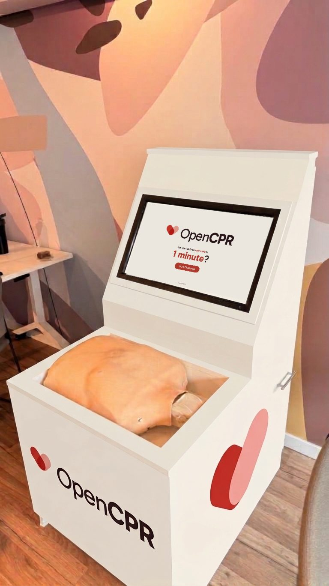
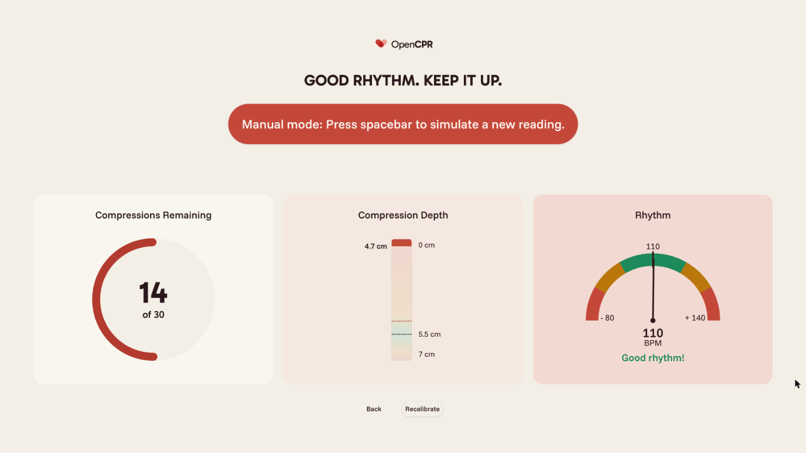
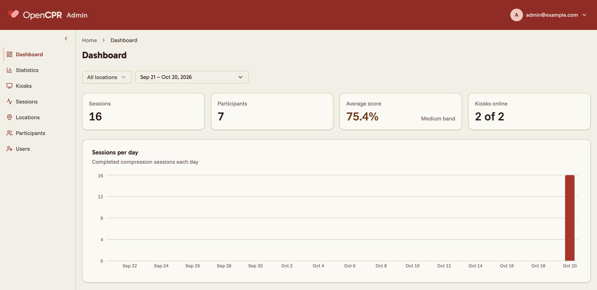
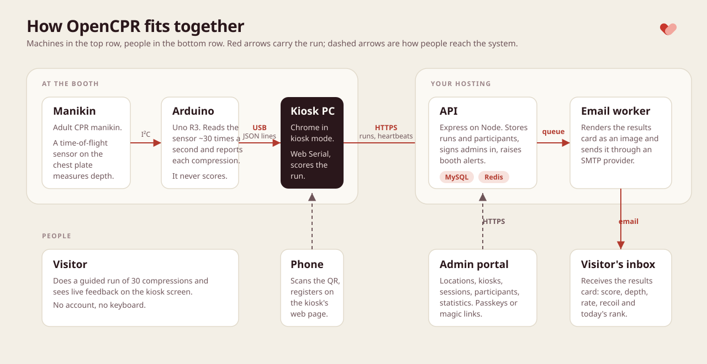
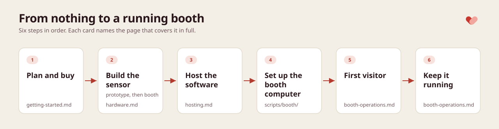

<!-- cspell:ignore Mailpit -->

# OpenCPR

Free, open-source software for a hands-only CPR training kiosk. A visitor walks up to a booth,
does a short guided run of 30 chest compressions on a training manikin, and sees live
feedback on depth, rate and recoil. Their result is scored on the spot and emailed to them. Organizations
such as cities, schools, hospitals and nonprofits can build and run a booth with the hardware
described here and the software in this repository.

OpenCPR is a training tool, not a medical device or a certification course. In an emergency,
call your local emergency number first.

Organizations that run a booth are responsible for their own deployment: the privacy policy
and consent their visitors see, how long participant data is kept, and local health and
safety rules. OpenCPR is provided as is, without warranty, under the [Apache License 2.0](LICENSE).

<p align="center">
  <br>
  <sub>An OpenCPR booth in a simple wooden cabinet (see <a href="docs/hardware.md#the-booth-cabinet">The booth cabinet</a>).</sub>
</p>

<p align="center">
  
  
</p>

## How a booth works

- A distance sensor inside the manikin's chest, read by an Arduino, measures every compression
  and streams it over USB to the booth computer.
- The kiosk app runs fullscreen in Chrome on a touchscreen. It guides the visitor, plays a
  metronome, scores the run and shows the result.
- The visitor registers on their own phone by scanning a QR code, so the kiosk never needs a
  keyboard.
- The API stores runs and participants, renders the results card and emails it. The admin
  portal shows locations, kiosks, sessions, participants and statistics, and raises alerts
  when a booth goes quiet.



## Documentation



New here? Start with [Getting started](docs/getting-started.md); it walks through the whole path in order.

| If you want to… | Read |
| --- | --- |
| Plan a booth and see what to buy | [Getting started](docs/getting-started.md) |
| Build the sensor | [Build the sensor](docs/hardware.md) |
| Host the software | [Host the software](docs/hosting.md) |
| Set up the booth computer | [Booth computer](scripts/booth/README.md) |
| Run a booth day to day | [Run a booth](docs/booth-operations.md) |
| Understand or change the code | [How it fits together](docs/architecture.md) |
| Find a quick answer | [FAQ](docs/faq.md) |

## What is in this repository

| Folder | What it is |
| --- | --- |
| [`docs/`](docs/README.md) | The guides: getting started, the sensor build, hosting, booth operations, architecture, FAQ |
| [`hardware/`](hardware) | The compression-sensor firmware and the 3D-printed case for the Arduino |
| [`frontend/`](frontend) | The kiosk app that runs on the booth screen (React + Vite) |
| [`backend/`](backend) | The scoring and admin API with the email worker (Node + Express + MySQL + Redis) |
| [`admin-portal/`](admin-portal) | The portal for locations, kiosks, participants and statistics (React + Vite) |
| [`scripts/booth/`](scripts/booth/README.md) | Booth computer setup for Ubuntu and macOS, and the firmware updater |

Each application folder has its own README with setup instructions and an `.env.example`
listing every variable it reads.

## Try it on your laptop

This brings up the whole stack locally with Docker so you can click through the kiosk and the
admin portal. It is a demo, not a production setup: a real booth needs the hosting described in
[Host the software](docs/hosting.md). On a server, use the production override instead:
`docker compose -f docker-compose.yml -f docker-compose.prod.yml up --build -d`. It publishes no
database, Redis or Mailpit port and never runs the seed.

```sh
cp .env.example .env
docker compose up --build
```

The first start creates the database schema and seeds an example location and the bootstrap
admin; later starts only apply new migrations.

| URL | What it is |
| --- | --- |
| <http://localhost:5173> | The kiosk app, as shown on the booth screen |
| <http://localhost:5174> | The admin portal |
| <http://localhost:8080> | The API (`/api/...`, `/health`) |
| <http://localhost:8025> | Mailpit, which catches every email the stack sends |

Without the sensor, pick manual mode on the kiosk's setup screen and the spacebar simulates
compressions. No email account is needed: every email, from the admin sign-in links to the
results cards, lands in Mailpit. To sign in to the admin portal, enter the
`BOOTSTRAP_ADMIN_EMAIL` address from `.env` (`admin@example.com` by default) and open the magic
link from Mailpit. Further users are invited from the portal.

MySQL is published on host port `3306` and Redis on `6379`. If a native install already owns
either port, set `MYSQL_HOST_PORT` or `REDIS_HOST_PORT` in `.env` to a free port.
`docker compose down -v` removes the database, the Redis data and the seed marker, so the next
start seeds again.

## Development

You need Node 24 and pnpm. Each application folder pins its Node version in `.nvmrc`, so run
`nvm use` inside it, and its pnpm version in the `packageManager` field of its `package.json`,
which `corepack enable` (run once) picks up. Run each application from its folder with
`pnpm install && pnpm dev`, starting with the backend, then the kiosk frontend and the admin
portal; each README lists the checks to run.

`pnpm install` at the repository root installs the git hooks: commit messages must follow
[Conventional Commits](https://www.conventionalcommits.org), and staged files are linted and
formatted with each folder's own ESLint and Prettier before the commit is created. CI runs
type-check, lint, format, spell-check and build for every folder on each pull request, runs the
tests for the kiosk (`frontend/`), and fails when the backend models change without a matching
migration.

## Contributing

Contributions are welcome. Read [CONTRIBUTING.md](CONTRIBUTING.md) for setup, commits and checks, and the [Code of Conduct](CODE_OF_CONDUCT.md). Report security problems privately as described in [SECURITY.md](SECURITY.md). Questions go to support@opencpr.org.

## License

OpenCPR is released under the [Apache License 2.0](LICENSE). See [NOTICE](NOTICE) for attribution and [CHANGELOG.md](CHANGELOG.md) for the changes in each release.

Built by [Light-it](https://lightit.io).
