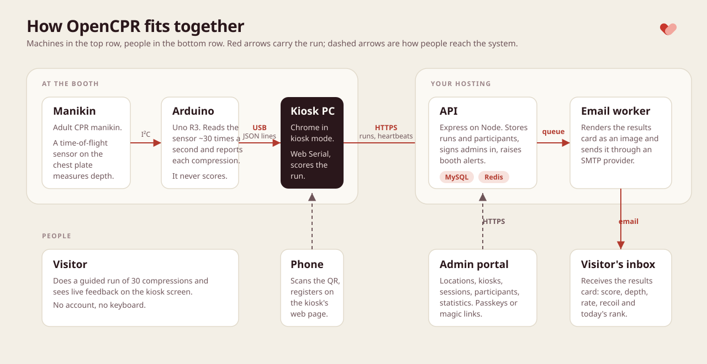

<!-- cspell:ignore VL53L4CD EEPROM resvg recalibrates recalibration -->

# How it fits together

Part of: [Getting started](getting-started.md) › Reference: understand or change the code

OpenCPR is four pieces of software and one small board. The board measures, the kiosk scores and shows, the API stores and emails, and the admin portal reads it all back.

## The four components

**Sensor and firmware** ([`hardware/`](../hardware)). A VL53L4CD time-of-flight sensor on the manikin's chest plate, read by an Arduino Uno R3 (or Mega 2560) running [`arduino.ino`](../hardware/arduino.ino). It owns stroke detection and the resting baseline, and reports JSON lines over USB serial: `ready`, `heartbeat`, `compression` and `error` frames. It decides nothing about CPR quality. See [Build the sensor](hardware.md).

**Kiosk** ([`frontend/`](../frontend)). A React app that runs fullscreen in Google Chrome on the booth computer. It owns the serial link (Web Serial), the participant flow from attract screen to results, live feedback and the metronome, scoring, and the outbox that keeps a finished run until the API has it. It also reports its own health to the API every two minutes and reloads itself when a new build is deployed.

**API** ([`backend/`](../backend)). Node 24 and Express with Drizzle ORM on MySQL and BullMQ on Redis. It owns the data: locations, kiosks, participants, sessions and their compressions, and the portal's users. It re-scores every run it stores and ranks it against the day's runs at its location, links phone registrations to runs, queues the results email, renders the results card and sends it over SMTP from the email worker, and runs the scheduled kiosk health check.

**Admin portal** ([`admin-portal/`](../admin-portal)). A React app for the people who run booths: fleet status, sessions with their compression charts, locations, participants, statistics, users and access requests. It signs in with magic links or passkeys and talks only to the API, under `/api/admin`.

## The life of a run

1. **Boot.** The board calibrates its resting baseline and sends a `ready` frame with `baselineMm`, `baselineOk` and its `deviceId`. The kiosk adopts the device ID as its kiosk ID and starts sending heartbeats to `POST /kiosks/:kioskId/heartbeat` every 2 minutes: serial status, time of the last good reading, baseline and build. A fault is reported after it has held for 10 s; a recovery at once.
2. **Attract screen.** `/` shows the start button. The serial link stays open on every screen, so a lost board shows a no-signal warning here; the kiosk reconnects on its own after 1, 2, 4 s and then every 5 s, and picks the port up again without a prompt when the USB cable is plugged back in.
3. **Registration.** `/register` shows a QR code pointing at `/r/<registrationId>` on the kiosk's public origin. The participant opens it on their phone and fills in name and email; the phone posts to `POST /cpr-sessions/:registrationId/claim`, and the kiosk, which polls `GET /cpr-sessions/:registrationId/claim`, moves on by itself. A participant who skips can still register after the run, but only if their phone opened the QR link before the skip, since the results screen shows no QR code; the claim and the run are linked whichever arrives first. The screen resets after 90 s without activity, with a 25 s warning.
4. **Instructions and countdown.** `/challenge/instructions` walks through positioning and technique. When the run starts the kiosk sends `R` to clear stroke tracking. If the board holds no trusted baseline it sends `C` once during the countdown, while the overlay asks for hands off the chest.
5. **The run.** The board streams `compression` frames; the kiosk records 30 of them, animates the depth bar from live readings, and keeps a 110 bpm metronome. A run left alone for 40 s is abandoned, with a 15 s warning.
6. **Scoring.** The kiosk derives rate, full depth and full recoil from the raw millimeters and timestamps in [`frontend/src/utils/session-scoring.ts`](../frontend/src/utils/session-scoring.ts), shows the results screen, and queues the run in its outbox, written to localStorage before the first attempt so a reload or a dead venue link cannot lose it.
7. **Saving.** The outbox posts to `POST /cpr-sessions`, retrying after 5 s, 15 s, 60 s and 5 minutes, then every 15 minutes, and again as soon as the browser goes back online. The API re-scores the compressions with the same rules, stores the run under the kiosk and location, links it to a waiting claim, and answers with today's rank, percentile and field size, which the results screen fills in. Sending the same `publicId` twice returns the stored run, so a retry is safe.
8. **Email.** Once a run has a participant with an email, from either direction, the API queues a results job on Redis. The email worker renders the results card from [`backend/public/results-template.html`](../backend/public/results-template.html) to PNG with satori and resvg and sends it inline over SMTP.
9. **Back to the start.** The results screen returns to the attract screen after 180 s, with a 15 s warning, and the board recalibrates 30 s after the chest goes still.

## Identity and data

**Kiosk ID.** The board mints a random UUID on first boot and keeps it in EEPROM, which survives power loss and firmware uploads. The kiosk uses it as its kiosk ID the moment the `ready` frame arrives, so the booth stays the same kiosk across computers, browsers and domains. Until the board speaks (manual mode, or no port yet) the kiosk uses a UUID it minted itself. A new board is a new kiosk.

**Participants and users.** Participants are the people who try the challenge at a booth: name and email from the phone form, matched by email across visits. Users are the people who sign in to the admin portal, with a role of `admin` or `viewer`; a viewer is read-only and can be limited to some locations. The two never mix. Only the admin portal shows names and emails; admins can export participants as CSV and delete a participant with their sessions.

**Locations.** Every kiosk and every run belongs to a location, which carries a timezone, start and end dates, optional opening hours, and an `alertsEnabled` flag. "Today" for a run's rank and the statistics is a calendar day in the location's timezone, and the kiosk health check only judges a kiosk during its location's opening hours, 24/7 when none are set.

**Kiosk health.** The API reduces each kiosk to one state: `offline` when there is no heartbeat for 5 minutes, `sensor` when the kiosk reports but its serial status is not `reading` or there has been no good reading for 30 minutes, otherwise `ok`. A scheduled job checks every 5 minutes and a heartbeat triggers a check at once; only a change between up (`ok`) and down (`offline` or `sensor`) is sent to Sentry, where alert rules decide who is told. A change between `offline` and `sensor` is recorded without an event. The kiosk's `/maintenance` screen releases the serial port and reports a `maintenance` status that holds alerts for up to 20 minutes, so a firmware update does not page anyone.

## Where to change what

| To change | Edit |
| --- | --- |
| Scoring rules and CPR targets (depth band, rate band, recoil) | [`frontend/src/utils/session-scoring.ts`](../frontend/src/utils/session-scoring.ts) for the kiosk, and [`backend/src/utils/session-scoring.ts`](../backend/src/utils/session-scoring.ts) with [`backend/src/utils/cpr-guideline.ts`](../backend/src/utils/cpr-guideline.ts) for the stored score. Keep them in step |
| Run length and the live depth bar | [`frontend/src/config/constants.ts`](../frontend/src/config/constants.ts) |
| Stroke detection, baseline checks, manikin calibration | [`hardware/arduino.ino`](../hardware/arduino.ino) |
| Serial link timing, reconnect and idle recalibration | [`frontend/src/hooks/use-serial-link.ts`](../frontend/src/hooks/use-serial-link.ts) |
| Heartbeat interval, fault confirmation, update polling | [`frontend/src/hooks/use-kiosk-monitor.ts`](../frontend/src/hooks/use-kiosk-monitor.ts) |
| Alert states and messages | [`backend/src/logic/kiosk-health.logic.ts`](../backend/src/logic/kiosk-health.logic.ts); the offline, stale and maintenance thresholds in [`backend/src/logic/kiosks.logic.ts`](../backend/src/logic/kiosks.logic.ts); the opening-hours rule in [`backend/src/utils/location-hours.ts`](../backend/src/utils/location-hours.ts); the schedule in [`backend/src/jobs/config.ts`](../backend/src/jobs/config.ts) |
| Email templates and the results card | [`backend/public/`](../backend/public): `email-template.html`, `results-template.html`, `magic-link-template.html`, `access-request-template.html`; the copy in [`backend/src/services/email/email.worker.ts`](../backend/src/services/email/email.worker.ts) |
| The printed case | [`hardware/hardware-case/uno_case.py`](../hardware/hardware-case/uno_case.py) |

Next: [FAQ](faq.md).
