<!-- cspell:ignore udev dialout journalctl systemctl loginctl ModemManager autoplay recalibrates recalibration EEPROM FQBN usbmodem -->

# Run a booth

Part of: [Getting started](getting-started.md) › First visitor and keep it running

What to do before the first day, what visitors see, what the booth does on its own, and what to check when something looks wrong. The computer setup itself is in [`scripts/booth/README.md`](../scripts/booth/README.md); this page does not repeat it.

## Before the first day

**Create the location.** Do this before setting up the booth computer: the kiosk cannot leave its setup screen without a location. In the admin portal, under Locations, create the venue with its name, country, city, address, start date and, if the booth is temporary, an end date, plus its IANA timezone and, if it closes at night, opening hours (`opensAt`, `closesAt`). The timezone decides what "today" means for a run's rank and the statistics; the dates and hours decide when a silent kiosk counts as a problem. Leave `alertsEnabled` off for a test or demo venue. The kiosk's setup screen lists only locations that are enabled and whose end date has not passed, so a location created a week early shows up at once.

  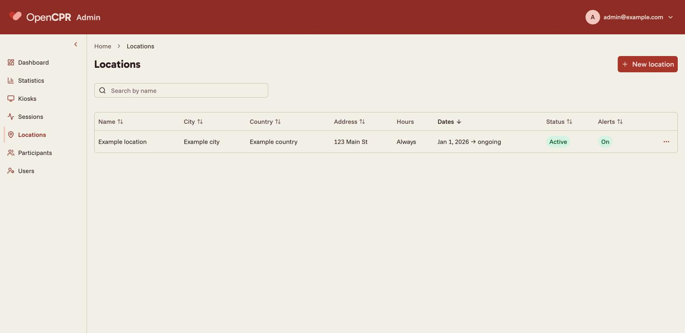
  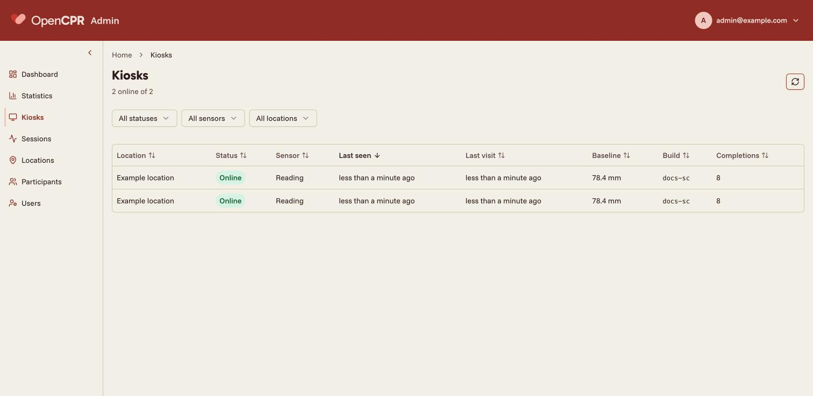

**Set up the booth computer.** Follow the [booth computer guide](../scripts/booth/README.md) for your platform. Its installer puts in place the Chrome serial policy and, on Ubuntu, the udev rule, so a board replaced or plugged back in during the day reconnects on its own.

**First run, with a keyboard.** After the reboot the computer logs in and the kiosk opens on `/setup`. Pick the language, the location and Arduino mode, and grant the serial port if Chrome asks (with the policy in place it does not). The grant lives in the kiosk's Chrome profile. Wait for the home screen, check that the booth appears under Kiosks in the admin portal with status `reading`, do one run yourself to the clicker, and then remove the keyboard. Calibrate the sensor for your manikin first if you have not: see [Build the sensor](hardware.md#calibrating-for-your-manikin).

## Daily operation

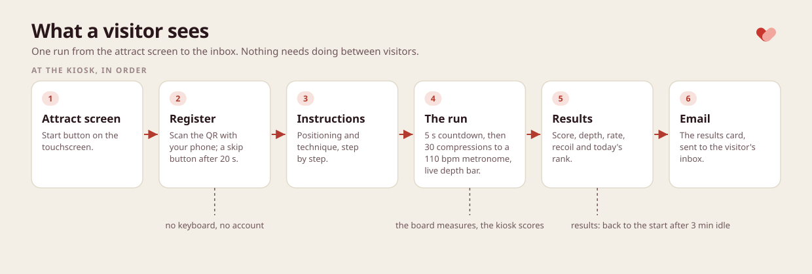

  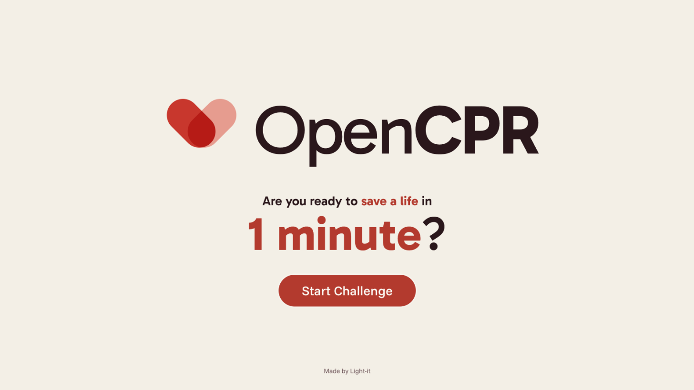
  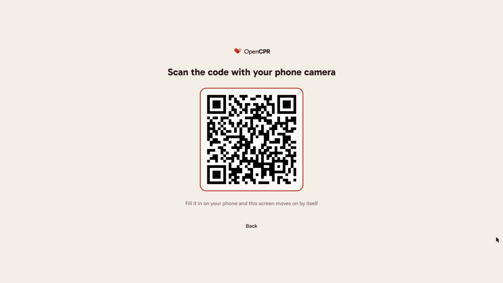
  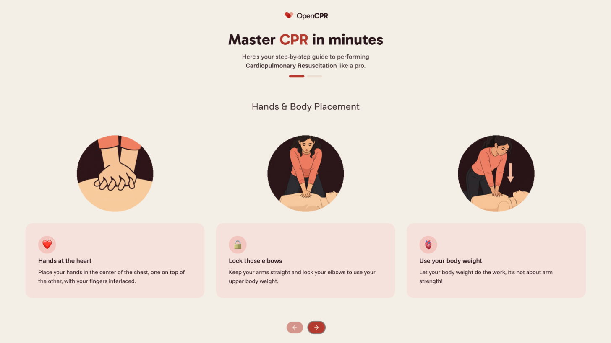

  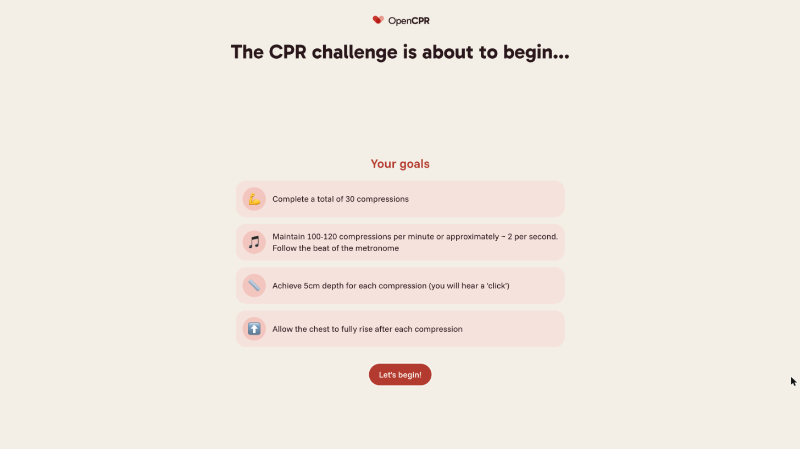
  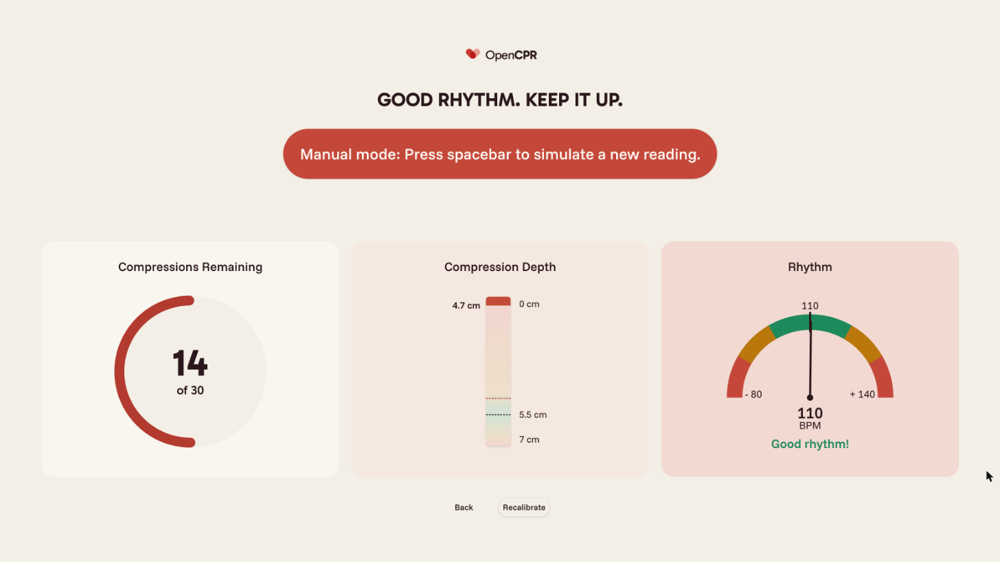
  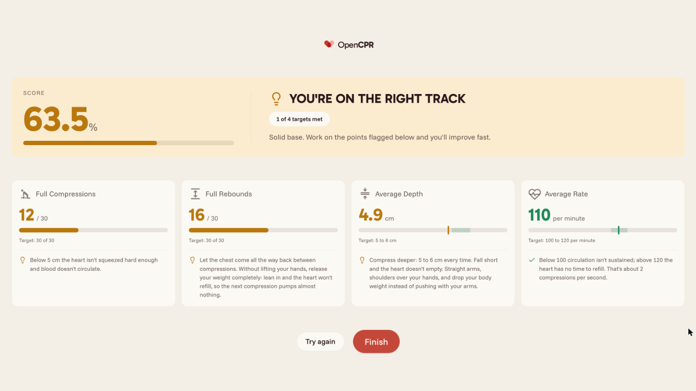

What a visitor sees, in order:

1. **Attract screen.** The start button. If the board is not talking, a no-signal banner shows here instead of letting anyone start.
2. **QR code.** The screen shows a QR code. The visitor scans it with their phone, which opens a short form on the kiosk's public address: first name, last name, email. As soon as the form is sent the kiosk moves on by itself. After 20 s a skip button appears for people without a phone. A skipped run is scored on screen like any other, but with no email address it cannot be emailed.
3. **Instructions.** Positioning and technique, step by step, on the touchscreen.
4. **The run.** A 5 s countdown asks for hands off the chest while the sensor settles. Then the visitor does 30 compressions to a 110 bpm metronome, with a live depth bar and the count remaining. The run ends at the 30th compression.
5. **Results on screen.** Score, depth, recoil and rate, and, once the API has the run, today's rank or percentile. The screen returns to the attract screen after 3 minutes without a touch.
6. **Results by email.** Once a registration is linked to the run, the API renders a results card and emails it. Registering before the run works, and so does sending the phone form after the run if the phone opened the QR link before the visitor skipped; the email is sent once per registration.

Between visitors, follow your organization's hygiene rules: wipe the manikin's face and chest, or change the face shield, as those rules and the manikin's maker require. The software needs nothing: the kiosk resets stroke tracking at the start of each run and retakes the sensor's baseline when the chest has been still for 30 s after a run.

## Running unattended

Everything in this table is what the deployed code does; the numbers come from the kiosk and API sources.

| Behavior | What happens |
| --- | --- |
| Build self-update | The kiosk checks `version.json` every 5 minutes and reloads only on the attract screen, so a deploy never interrupts a run. It will not reload twice for the same build |
| API heartbeat | Every 2 minutes, carrying serial status, time of the last good reading, baseline and build id. A status change is sent at once; a fault only after it has held 10 s; a recovery immediately. The first beat waits up to 15 s for the board |
| Inactivity resets | Registration screen: 90 s, with a 25 s countdown warning. Abandoned run: 40 s without a compression, 15 s warning. Results screen: 180 s, 15 s warning |
| Serial reconnect | The link stays open on every screen. No frame for 6 s counts as lost; the kiosk retries after 1, 2 and 4 s, then every 5 s, and reopens the granted port as soon as the board is plugged back in, without a prompt |
| Self-recalibration | 30 s after a run once the chest is still, then every 30 minutes while idle. After a bad or refused baseline: 15 s, 30 s, 60 s, then every 2 minutes. A run that starts without a trusted baseline takes one during the countdown |
| No-signal warning | A banner on the attract screen whenever the serial status is lost, disconnected or faulty; it clears when the next frame arrives |
| Save outbox | A finished run is written to the browser's localStorage before the first send and retried after 5 s, 15 s, 60 s and 5 minutes, then every 15 minutes, and as soon as the browser is back online. Up to 200 runs wait; a run unsaved for 10 minutes is reported to Sentry; the API accepts a repeated run without duplicating it |
| Chrome restarts (Ubuntu only) | The systemd service restarts Chrome 3 s after it exits for any reason, and the launcher waits for the network and for `KIOSK_URL` to answer before starting it. On macOS nothing restarts Chrome: run `start-kiosk.command` again |

## Alerts

The API runs a health check every 5 minutes and also judges a kiosk right after each heartbeat. Each kiosk is reduced to one state:

- `offline`: no heartbeat in the last 5 minutes.
- `sensor`: the kiosk reports, but its serial status is not `reading`, or it has had no good reading for 30 minutes.
- `ok`: neither.

Only a change between up and down is reported: `ok` to `offline` or `sensor` is a Sentry `warning`, back to `ok` is a Sentry `info` event ("recovered"), and a booth first seen healthy is recorded without an event. A change between `offline` and `sensor` is recorded without an event, since the booth is down either way. Each transition is its own Sentry issue, so a repeat outage is never folded into an old, resolved one.

Checks happen only when the booth should be up: the location exists and has `alertsEnabled` on, today is within its start and end dates, and the local time is inside its opening hours (24/7 when none are set). Outside those windows the stored state is frozen rather than muted, so a booth that is still down 10 minutes after opening raises exactly one alert and switching it off at closing time raises none.

Sentry is optional. Without `SENTRY_DSN` on the API the events are dropped and the Kiosks page of the admin portal is the only place to look. With it, Sentry alert rules decide who is told and how; recipients are managed there, not in OpenCPR.

## Maintenance mode

`/maintenance` on the kiosk is a hands-off screen that closes the serial port and reports a `maintenance` serial status in its heartbeats. The API skips a kiosk in that state, so flashing firmware or swapping a board pages nobody. The silence holds for 20 minutes from the last maintenance heartbeat; the page keeps sending them every 2 minutes, and a booth that stops reporting mid-update is judged as usual once the 20 minutes are up, so a failed update still gets noticed. Any ordinary heartbeat ends maintenance at once.

On Ubuntu, `update-firmware.sh` uses it: it compiles first, then switches the kiosk to `/maintenance` (through Chrome's DevTools port, or by restarting the service with that path), waits 8 s for the page to load and send its heartbeat, flashes the board, waits for the board's own calibration, and sends the kiosk back to `/`. The board's device ID, and with it the kiosk's identity, survives the upload. If an upload fails the booth stays on the maintenance screen; run the script again until it succeeds. On a Mac, `update-firmware.command` does the same, pointing the kiosk window at `/maintenance` or restarting Chrome on it.

## Troubleshooting

| Symptom | Likely cause | Fix |
| --- | --- | --- |
| No-signal banner on the attract screen | USB cable loose, board rebooting, or the board is calibrating (it goes quiet for about 3 s) | Wait 10 to 20 s. Then unplug the USB cable and plug it back in; the kiosk reconnects by itself. Then restart the kiosk: on Ubuntu, `systemctl --user restart opencpr-kiosk`; on macOS, quit Chrome with Cmd+Q and run `start-kiosk.command` again |
| Scores look wrong for everyone | Someone leaned on the chest while the board calibrated, so the baseline is off | Leave the chest alone for 30 s; the kiosk recalibrates. Or power-cycle the board (unplug and reconnect USB) with nobody touching the manikin |
| Chrome asks for the serial port, or finds none | Policy, udev rule or group missing, or a clone board with a non-Arduino USB chip | On a keyboard, `chrome://policy` must list `SerialAllowUsbDevicesForUrls` with the exact `KIOSK_URL`. On Ubuntu, `ls -l /dev/ttyACM*` must show group `dialout` and mode `crw-rw----`, and `groups` must include `dialout` (needs a re-login). On macOS only the policy applies: run `install-chrome-serial-policy.command` again and restart the kiosk. A clone board: grant it once by hand from `/setup` |
| Updater says no board found | Cable or port, a clone board arduino-cli cannot identify, or ModemManager holding the port right after plugging in | `ls -l /dev/ttyACM*` on Ubuntu, `ls /dev/cu.usbmodem*` on macOS; try another cable or port; for a clone, set both `ARDUINO_FQBN` and `SERIAL_PORT` (for example `/dev/ttyACM0`) in `booth.env`, since the updater refuses `SERIAL_PORT` alone; on Ubuntu, wait ten seconds after plugging in |
| No metronome sound | Wrong audio output selected | With a keyboard, pick HDMI or the 3.5 mm jack in GNOME Settings, Sound on Ubuntu, or in System Settings, Sound on macOS. It is remembered. The launcher lets Chrome autoplay, so no tap is needed |
| Screen blanks or locks | System settings lost, or the monitor's own power saving | On Ubuntu, re-run `install-booth.sh`, which reapplies the GNOME settings. On macOS, check Displays, Advanced, prevent sleeping on power adapter. Turn off power saving in the monitor's menu |
| Kiosk does not come up after boot | On Ubuntu, the service failed or the user session does not linger. On macOS, automatic login or the Login Item is missing | On macOS, check automatic login and that `start-kiosk.command` is a Login Item. On Ubuntu, `journalctl --user -u opencpr-kiosk` shows why. `systemctl --user status opencpr-kiosk` is `inactive` until the graphical session is up; if `loginctl show-user kiosk -p Linger` is not `yes`, run `sudo loginctl enable-linger kiosk` |
| Kiosk stuck on a wrong screen | A run or an update left Chrome somewhere odd | On Ubuntu, `systemctl --user restart opencpr-kiosk` over ssh or on Ctrl+Alt+F3; on macOS, restart the kiosk with `start-kiosk.command`. Or power-cycle the booth |
| Booth missing from the admin portal | No internet, setup not completed, or a new board | The kiosk only reports once `/setup` has a location; check the network; a new board is a new kiosk ID, so it appears as a new row |
| Results email never arrives | No registration linked, SMTP settings or sender wrong, or the run is still in the outbox | Check the session under Sessions in the portal: a participant must be linked; check the `SMTP_*` settings and `EMAIL_FROM_ADDRESS` on the API; a run that has not reached the API yet has no email |
| Alert fired outside opening hours | The location has no hours set, so it is monitored 24/7 | Set `opensAt` and `closesAt` on the location, with the right timezone |

## Data and privacy

  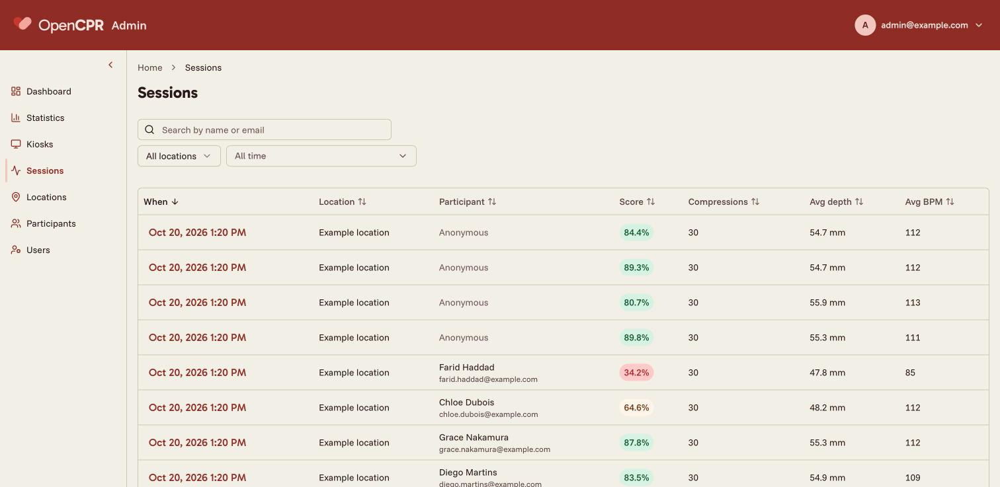
  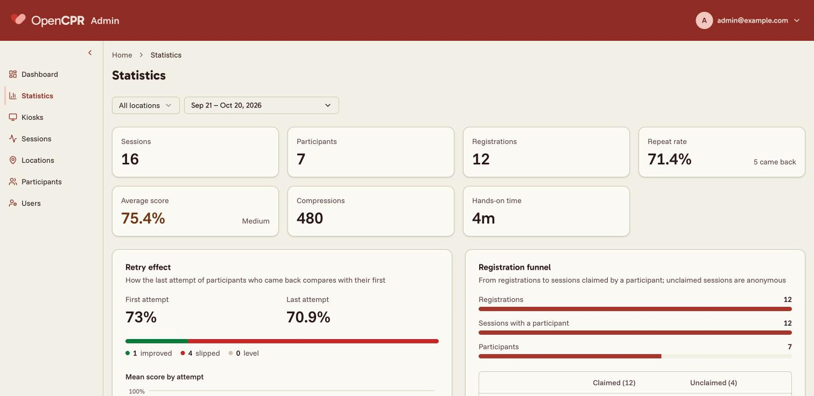

Participants register on their own phone, never on the booth's screen. The API stores each participant's first name, last name and email, and each run's score, metrics, compressions, kiosk and location. The kiosk keeps a run in localStorage only until the API has it.

Names and emails are shown only in the admin portal, which is invite-only and signs in with magic links or passkeys. Users with the `viewer` role are read-only and can be limited to some locations; every write and the export need the `admin` role. Admins can export participants as a CSV, filtered by location and dates, and delete a participant, which removes their runs, compressions and registrations with them. Kiosk heartbeats carry no personal data.

If the kiosk is configured with a Sentry DSN, session replays mask every input and anything tagged for masking, and block media, so a replay never shows a name or an email. Alerts carry the kiosk ID and location name, nothing about participants.

## After the event

When a temporary booth closes:

1. **Export what you need.** Under Participants in the admin portal, export the CSV, filtered by location and dates. The export needs the `admin` role.
2. **Delete what you should not keep.** OpenCPR has no automatic retention or deletion: participant data stays until an admin deletes it. The admin portal deletes participants one at a time, and each deletion removes their runs, compressions and registrations. Decide what to keep from your privacy policy.
3. **Decide on the location.** Keep it for its history, or rename it so it reads as a past event. Once its end date has passed, the kiosk setup screen no longer lists it and its booth is no longer checked for alerts.
4. **Take the sensor out of a borrowed manikin.** Remove the sensor, its mount, the cable and any putty or tape, so the manikin goes back unmarked. In another manikin, [calibrate](hardware.md#calibrating-for-your-manikin) again.
5. **Back up the database.** See [Backups](hosting.md#backups).

Next: [How it fits together](architecture.md).
