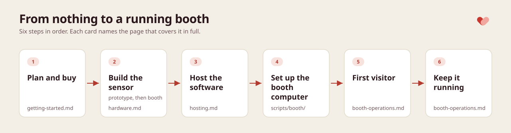

<!-- cspell:ignore VL53L4CD manikin PETG Qwiic STEMMA Adafruit VESA -->

# Getting started: from nothing to a running booth

The roadmap. It decides whether OpenCPR fits, plans the booth, lists what to buy, and then points to the page that owns each remaining step.

## Is this for you

OpenCPR is a hands-only CPR practice booth: a visitor compresses a manikin's chest for 30 compressions, sees depth, recoil and rate live, gets a score, and receives a results card by email. It is a training tool for public spaces. It is not a medical device, it certifies nobody, and in an emergency the local emergency number comes first.

Running one means committing to:

- [ ] an adult CPR manikin with a hinged chest plate
- [ ] a sensor kit: an Arduino, a time-of-flight sensor, a cable and a printed case
- [ ] a small computer and a touchscreen at the booth, with power and internet
- [ ] somewhere to run three small web services (the API, the kiosk app and the admin portal), on your own server or at a hosting provider
- [ ] an SMTP email account at any provider, for the results emails and the admin sign-in links
- [ ] someone who can follow a shell guide once, and someone who answers when the booth alerts

## Plan the booth

- [ ] **Where and when.** The venue, its start date and, for a temporary booth, its end date. Its timezone decides what "today" means for a run's rank.
- [ ] **Opening hours.** If the venue closes at night, note the hours: the health check only judges the booth while it should be up, and a booth with no hours is monitored around the clock.
- [ ] **Who gets alerts.** Alerts go to Sentry, where alert rules route them to email or chat. Decide who that is, or decide to run without Sentry and watch the admin portal's Kiosks page instead.
- [ ] **Who maintains it.** One person who can plug in a keyboard, run the firmware updater over ssh, and recalibrate after a manikin change. See [Run a booth](booth-operations.md).

## Choose your level

| | Software only | Prototype | Full booth |
| --- | --- | --- | --- |
| What you build | The whole stack on your laptop | The sensor on a plug-in JST cable, read by the kiosk on your laptop | A permanent booth: the sensor in the manikin, the case, a booth computer and a touchscreen |
| Hardware needed | None | An Arduino, the sensor breakout, a JST-to-pin cable, a USB cable | The prototype kit plus everything in [Full booth](#full-booth) below |
| What it proves | The kiosk, scoring, admin portal and emails, with the spacebar standing in for the sensor | Wiring, firmware, live depth and a first calibration | Unattended daily use with real visitors |
| Rough effort | Under an hour | An afternoon | A few days, plus printing and setup |

Go level by level: each one checks the parts the next one builds on, and the first two cost little.

## What to buy

Specs, part choices and the reasons behind them are in [Build the sensor](hardware.md#what-you-need); computer requirements are in [Choosing the computer](../scripts/booth/README.md#choosing-the-computer). Software only needs nothing: see [Try it on your laptop](../README.md#try-it-on-your-laptop).

The list assumes the basics most people already own: a laptop with Google Chrome, small screwdrivers, scissors and tape. Links are examples from common vendors; any equivalent part works.

### Prototype

The cheapest part, a few small components that later go into the booth:

- [ ] 1 Arduino Uno R3 (a Mega 2560 also works), for example the [Arduino UNO Rev3](https://store.arduino.cc/products/arduino-uno-rev3)
- [ ] 1 VL53L4CD time-of-flight breakout with a 4-pin JST SH connector (1.0 mm pitch, sold as STEMMA QT or Qwiic), for example the [Adafruit VL53L4CD](https://www.adafruit.com/product/5396)
- [ ] 1 JST SH (STEMMA QT / Qwiic) to male-pin cable, for example the [Adafruit STEMMA QT / Qwiic JST SH 4-pin to male headers cable](https://www.adafruit.com/product/4209)
- [ ] 1 USB-A to USB-B cable

### Full booth

Everything above, plus:

**Manikin**

- [ ] 1 adult CPR manikin, hinged chest plate, ideally with a depth clicker (the largest single cost; a used one is fine)

**Sensor kit**

- [ ] 1 screw-terminal shield for the Uno (or the Mega)
- [ ] 1 short 4-pin JST SH lead with bare wire ends at the other end
- [ ] up to 1.5 m of 4-core 26 AWG cable, for example UL2464 4×26 AWG
- [ ] ferrules sized for 26 AWG wire, for the board end, and heat-shrink sized for 26 AWG wire, for the four joints
- [ ] the printed case: a spool's worth of PETG or PLA, 4 M3×6 screws, 2 wood screws, a zip tie

**Booth computer and screen** (a refurbished mini PC costs about as much as the manikin's accessories; a new touchscreen is the second-largest cost)

- [ ] 1 x86-64 mini PC meeting the requirements (refurbished business minis are good value), or a Mac you already have
- [ ] 1 24" touchscreen: landscape, 1920×1080, touch over USB, with a VESA mount; with its HDMI or DisplayPort cable and its USB touch cable
- [ ] speakers, if the touchscreen has none: the metronome needs audio
- [ ] 1 Ethernet cable to the venue's network, or a reliable Wi-Fi connection
- [ ] a keyboard, for setup days only

**Consumables and the table**

- [ ] manikin face shields or wipes, as your manikin's maker recommends
- [ ] a sturdy table at kneeling height, or a [booth cabinet](hardware.md#the-booth-cabinet) built around the manikin and the screen; a mat; and a way to fix the case to it
- [ ] adhesive putty or tape for the sensor mount, zip ties, a power strip

### Tools

For the full booth build:

- [ ] a soldering iron and solder
- [ ] a wire stripper for 26 AWG wire
- [ ] a ferrule crimper
- [ ] a heat gun, or a lighter, for the heat-shrink
- [ ] a 3D printer, or a print service, for the case
- [ ] a USB stick of 8 GB or more, for the Ubuntu installer

## The path

Planning and buying are step 1. The rest happens in this order, and each step's page has the full detail:

2. **Build the sensor.** Build the prototype on your desk first: the sensor on a plug-in JST cable, the firmware and live depth on your laptop. Then wire it for the booth, mount it in the manikin, print the case and calibrate it against the clicker. [Build the sensor](hardware.md)
3. **Host the software.** Run the API, the kiosk app and the admin portal on public HTTPS addresses, with MySQL, Redis and an SMTP email account. [Host the software](hosting.md)
4. **Create the location.** Sign in to the admin portal as the bootstrap admin and create the venue under Locations. Do this before the booth computer: the kiosk cannot leave its setup screen without a location. [Before the first day](booth-operations.md#before-the-first-day)
5. **Set up the booth computer.** Install Chrome in kiosk mode, the serial-port policy and the firmware updater on Ubuntu or macOS, then flash the board once with the updater. [Booth computer](../scripts/booth/README.md)
6. **First visitor.** Complete the kiosk's setup screen with a keyboard, do one run yourself and check the results email arrives. [Before the first day](booth-operations.md#before-the-first-day)
7. **Keep it running.** Software updates reach the booth on their own; firmware updates, alerts and troubleshooting are in [Run a booth](booth-operations.md).

To look around before buying anything, run the whole stack on a laptop: [Try it on your laptop](../README.md#try-it-on-your-laptop).

Next: [Build the sensor](hardware.md).
