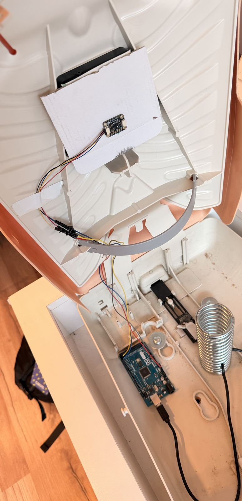
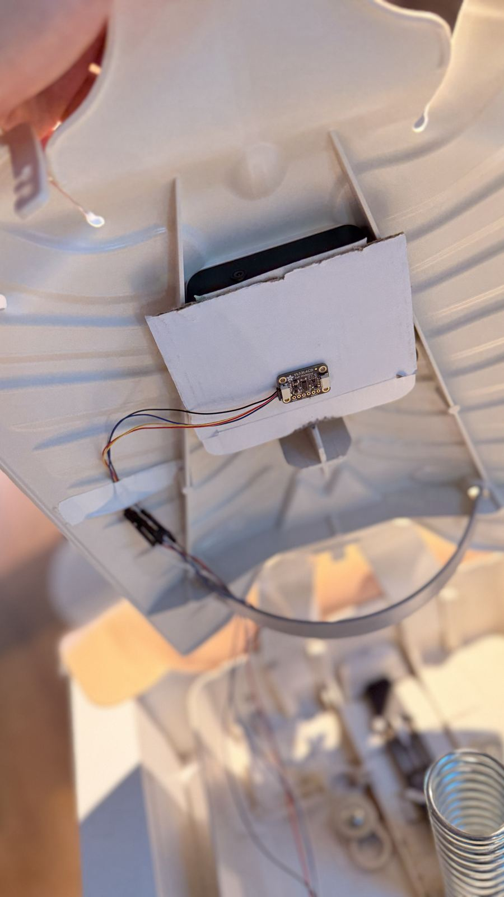
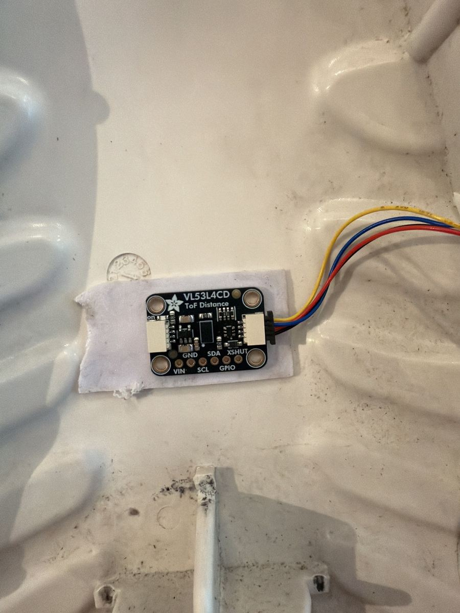
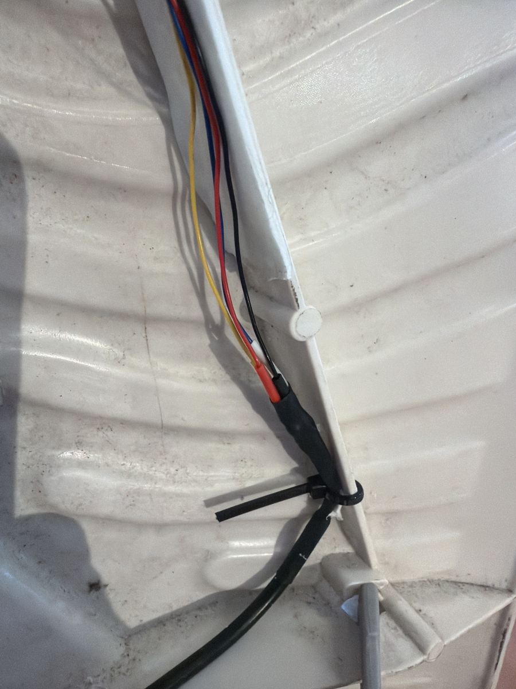
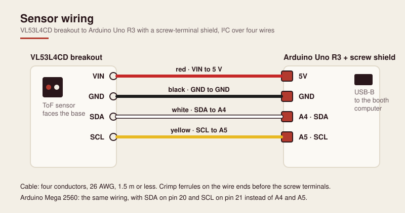
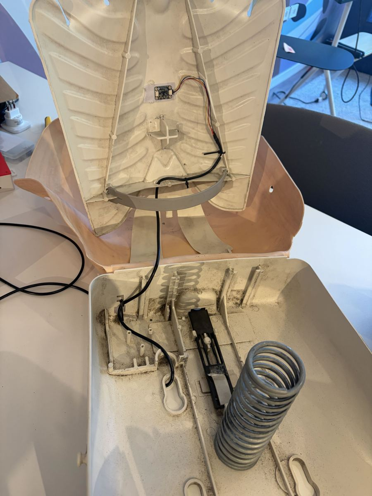
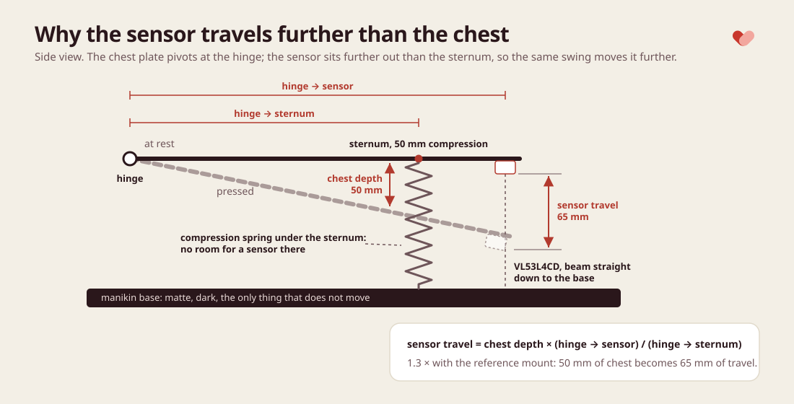
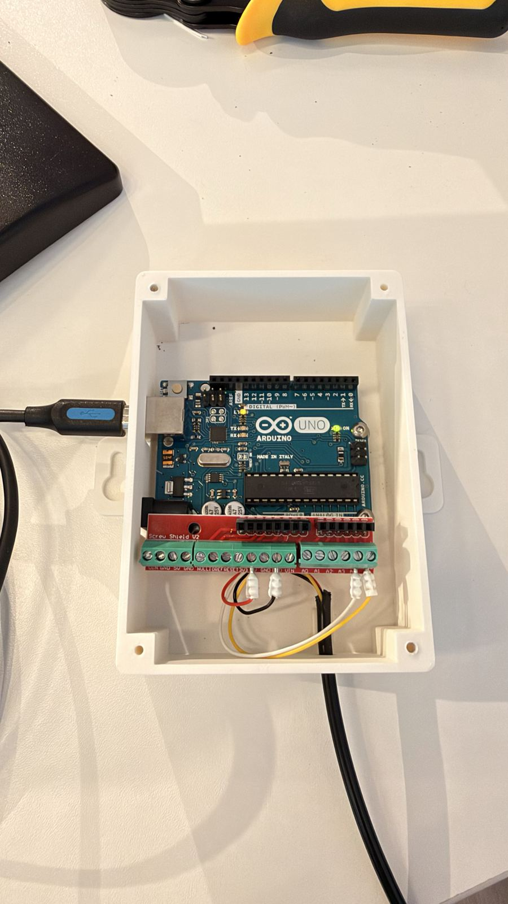
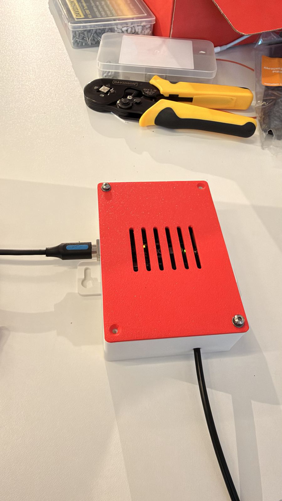

<!-- cspell:ignore VL53L4CD STM32duino ArduinoJson EEPROM FQBN fqbn baudrate Ryzen PETG manikin manikins ferrules recalibration recalibrates Qwiic STEMMA Adafruit -->

# Build the sensor

Part of: [Getting started](getting-started.md) › Build the sensor

How to build, wire, flash and calibrate the compression sensor that an OpenCPR booth reads. The firmware and the printed case live in [`hardware/`](../hardware); this page is the build guide around them.

## What you need

| Part | Spec or example | Role | Needed for |
| --- | --- | --- | --- |
| Arduino Uno R3 | A Mega 2560 also works | Reads the sensor and reports depth over USB | Prototype and booth |
| VL53L4CD breakout | ST time-of-flight distance sensor, I²C, 3.3 to 5 V tolerant breakout, with a 4-pin JST SH connector (1.0 mm pitch, sold as STEMMA QT or Qwiic) | Measures the distance from the chest plate to the manikin's base | Prototype and booth |
| USB cable | USB-A to USB-B, 1 to 2 m | Board to the laptop or the booth computer | Prototype and booth |
| JST to male-pin cable | 4-pin JST SH (STEMMA QT / Qwiic) to male header pins | Plugs into the breakout's connector and into the Arduino's headers | Prototype |
| Adult CPR manikin | Hinged chest plate; ideally with a mechanical depth clicker | The chest the participant compresses. The clicker makes calibration a two-minute job | Booth (optional for the prototype) |
| Screw-terminal shield | "Screw Shield V2" or similar, for the Uno (or the Mega) | Holds the cable ends under screws | Booth |
| Sensor cable | A short 4-pin JST SH lead with bare wire ends, soldered to one 4-core 26 AWG cable (for example UL2464 4×26 AWG), 1.5 m or less in total, with crimped ferrules on the board end | Carries power and I²C from the sensor to the board | Booth |
| Printed case | [`hardware/hardware-case/`](../hardware/hardware-case) | Holds the Uno and shield, gives the cable strain relief, screws to a panel | Booth |

The shopping list with quantities is in [Getting started, What to buy](getting-started.md#what-to-buy); this table gives the spec and role of each sensor part, and which level needs it: the [prototype](#prototype-on-your-desk) or the full booth. The booth computer and touchscreen requirements are in [Choosing the computer](../scripts/booth/README.md#choosing-the-computer).

## Why these parts

**Time-of-flight over anything else.** A VL53L4CD has a narrow beam and millimeter resolution, which is what a small, dark chest cavity needs: an ultrasonic sensor's cone bounces off the cavity walls. A potentiometer, encoder or linear slide needs a mechanical coupling to the manikin, which is something to break and something that marks a manikin you may not own. An accelerometer gives depth only after double integration, which drifts; time-of-flight reads absolute distance. The chest plate is matte and the cavity is dark, which is the ideal target for a time-of-flight sensor. How it works, what was tried before it and what to check before using another sensor are in [The compression sensor](sensor.md).

**Uno R3 over Mega 2560.** Cheaper, smaller, same AVR core and the same 5 V I²C. The sketch fits with room to spare, and screw-terminal shields for the Uno are everywhere. The Mega runs the same sketch unchanged, so use one if it is what you have; only the I²C pins and the board name you flash with differ.

**Measurement-only firmware.** The board reports what it measured: timestamps and millimeters. Whether a compression was deep enough, released fully or at the right rate is decided on the kiosk, in one scoring module. The board and the app can never disagree, and past runs can be re-scored when the rules change.

**A mini PC running Chrome.** The kiosk talks to the board over Web Serial, which only Chrome and Edge implement, and the booth runs Google Chrome's official build. So the booth computer is an x86-64 mini PC with Ubuntu (recommended) or a Mac. A refurbished business mini is cheap, quiet, and often better value than a new N100 box. It boots into the kiosk by itself after a power cut, and nothing else runs on it.

## Prototype on your desk

The prototype is the board and the sensor joined by one plug-in cable, read by the kiosk on your own laptop. There is no breadboard, no soldering, no shield, no case and no booth computer or touchscreen. Run the stack as in [Try it on your laptop](../README.md#try-it-on-your-laptop) and open the kiosk in Chrome: Web Serial works on `http://localhost`, so the local kiosk can open the board.

Most VL53L4CD breakouts have a 4-pin JST SH connector (1.0 mm pitch, sold as STEMMA QT or Qwiic). Use a JST-to-male-pin cable: the JST end clicks into the breakout and the four pins go straight into the Arduino's headers. Wire colors depend on the cable, so match by signal; the common STEMMA QT colors are:

| Wire | Signal | Uno R3 | Mega 2560 |
| --- | --- | --- | --- |
| Black | GND | GND | GND |
| Red | Power | 5V | 5V |
| Blue | SDA | A4 | 20 (SDA) |
| Yellow | SCL | A5 | 21 (SCL) |

If your breakout has no JST connector, four male-to-female jumper wires do the same job: female end on the breakout pin, male end in the header.

Flash the board from the laptop with `arduino-cli` or the Arduino IDE, as described in [Flashing](#flashing).

**Without a manikin.** The board takes its baseline at boot, so before you plug it in, point the sensor at a matte surface a few centimeters away, such as a card propped on a stack of books, and keep it still. Then open a serial monitor at 115200 baud and move a hand or a matte card toward the sensor: `depthMm` in the `heartbeat` frames, every 500 ms, rises as the target gets closer. Until you calibrate, the numbers are scaled for the reference mount, not true chest depth. To see the full loop, run the kiosk in Arduino mode on `/setup`, pick the board's port, and watch the live depth bar and the score.

**With a manikin.** Tape the breakout temporarily to the underside of the chest plate, clear of the sternum spring and pointing at the base, as in [Mounting the sensor](#mounting-the-sensor), and start [calibrating](#calibrating-for-your-manikin).

<p align="center">
  
  <br>
  <sub>Prototype: the sensor on a card, plugged straight into a Mega's headers with jumper wires. An Uno works the same way, and so does a JST-to-male-pin cable.</sub>
</p>

**What it proves.** The wiring, the firmware, the [serial protocol](#serial-protocol), the kiosk's live depth bar and scoring, and a first calibration.

**What it does not.** A permanent mount, cable strain relief, or reliability without anyone watching. Pins pushed into headers loosen with vibration and handling, so a booth that runs all day keeps the JST plug at the sensor and moves the board end into screw terminals, as below.

## Wiring for the booth

The sensor keeps its JST plug, so the breakout itself is never soldered. The cable is built from two parts:

1. **At the sensor:** a short 4-pin JST SH lead with bare wire ends plugs into the breakout. Solder each of its four wires to the matching wire of one 4-core cable (for example UL2464 4×26 AWG) and cover each joint with heat-shrink. These four joints are the only soldering in the build.
2. **At the board:** crimp a ferrule onto each of the four wires at the other end of the 4-core cable and tighten them into the screw terminals on the shield:

<p align="center">
  
  <br>
  <sub>Booth build: the JST lead at the sensor, and its four soldered joints to the 4-core cable under heat-shrink.</sub>
</p>

Match each wire by signal, from the breakout pin through the JST lead and the 4-core cable to the shield's terminal:

| Signal | Breakout pin | JST lead wire | 4-core cable wire | Uno R3 terminal | Mega 2560 terminal |
| --- | --- | --- | --- | --- | --- |
| Ground | GND | Black | Black | GND | GND |
| Power | VIN | Red | Red | 5V | 5V |
| Data | SDA | Blue | White | A4 | 20 (SDA) |
| Clock | SCL | Yellow | Yellow | A5 | 21 (SCL) |

Wire colors depend on the cable, so match by signal, not by color. The JST lead column and the prototype table use the common STEMMA QT colors (blue for SDA); the 4-core cable column is the cable used in this build. Note your own colors before you solder.

The breakout takes 5 V on VIN: the Adafruit VL53L4CD breakout has its own regulator and level shifting and works from 3 to 5 V. With another breakout, check that it accepts 5 V on VIN.



The sketch calls `Wire.begin()` with the default pins, so no pin numbers change between the two boards. Crimp ferrules on the wire ends instead of tinning them: a solder-tinned strand creeps under a screw terminal and comes loose. Keep the sensor cable at 1.5 m or less; the bus runs with a 3 ms timeout and recovers from a glitch, but a long unshielded run invites them.

## Mounting the sensor

The sensor rides the hinged chest plate, inside the chest cavity, pointing straight at the manikin's base. The base is the target: matte, dark, and the only thing that does not move. It cannot sit at the sternum: the manikin's large compression spring stands there, between the plate and the base, so the sensor goes further out along the plate where the beam reaches the base unobstructed. Avoid pointing at anything glossy and keep the beam clear of ribs, the spring and the clicker mechanism.

A simple mount works: the breakout on a small piece of stiff card or a printed bracket, fixed to the underside of the plate with adhesive putty or double-sided tape. Route the cable so the plate can hinge freely, and strain-relieve it with the zip tie at the case so a tug on the cable pulls on the case, not on the terminals.

<p align="center">
  <br>
  <sub>Booth build: the sensor under the chest plate, its cable tied along the plate and out of the base.</sub>
</p>

Because the sensor sits further from the hinge than the sternum, it travels further than the chest does:

```text
sensor travel = chest depth × (hinge → sensor) / (hinge → sternum)
```

With the sensor 1.3 times further from the hinge than the sternum, a 50 mm compression moves the sensor 65 mm. That ratio is the board's depth scale, and it is what you calibrate below. At rest the firmware reads 0 mm, so the error is a pure scale factor, not an offset.

If your manikin has room to fix the sensor inside the chest at the compression point instead, so that it moves with the sternum, the sensor travels exactly as far as the chest and the scale is 1.0.



## Flashing

The booth computer flashes the board with [`scripts/booth/ubuntu/update-firmware.sh`](../scripts/booth/ubuntu/update-firmware.sh) (or [`scripts/booth/macos/update-firmware.command`](../scripts/booth/macos/update-firmware.command) on a Mac). On Ubuntu, `arduino-cli` comes from `install-booth.sh`, and the updater stops if it is missing; on a Mac, the updater offers to install it. The updater installs the AVR core and the two pinned libraries, parks the kiosk on its maintenance screen, uploads, and brings the kiosk back. It detects whether an Uno or a Mega is plugged in; set `ARDUINO_FQBN` in the booth configuration (`arduino:avr:uno` or `arduino:avr:mega`) to pin the board, or for a clone the detection cannot identify. See the [booth guide](../scripts/booth/README.md).

To flash from any other machine with `arduino-cli`, the sketch folder must carry the sketch's name:

```sh
mkdir -p build/arduino && cp hardware/arduino.ino build/arduino/
arduino-cli core install arduino:avr
arduino-cli lib install "ArduinoJson@7.4.3" "STM32duino VL53L4CD@1.0.5"
arduino-cli compile --fqbn arduino:avr:uno build/arduino
arduino-cli board list                      # find the port
arduino-cli upload --fqbn arduino:avr:uno -p /dev/ttyACM0 build/arduino
```

In the Arduino IDE, open `hardware/arduino.ino` (the IDE offers to move it into a folder of its own), install the same two libraries from the Library Manager, pick **Arduino Uno** as the board, and upload. The sketch does not compile with ArduinoJson 6.

The board keeps its device ID across uploads: it lives in EEPROM, which a sketch upload does not touch.

## Calibrating for your manikin

The board divides sensor travel by a depth scale to get chest depth. The scale belongs to the manikin and its mount, not to the board, so each board stores its own in EEPROM and you set it once per installation with the `S` command. Recalibrate when you move from the taped prototype to the permanent mount: a sensor that sits in a different place on the plate travels a different distance. A board with nothing stored uses the default for the reference hinged-plate mount, 1.3, which comes from two constants at the top of `hardware/arduino.ino`:

```cpp
const float sensorTravelAtClickMm = 65.0; // MEASURED
const float clickerDepthMm = 50.0;        // ASSUMED: AHA adult minimum
```

Pick the scale by mount:

- **Sensor on a hinged chest plate,** further from the hinge than the sternum: the ratio of the two distances, about 1.3 for the reference mount. Measure it against the depth clicker as below.
- **Sensor fixed inside the chest at the compression point:** 1.0.
- **Unsure:** start from the default, do the sanity check below with good technique at full guideline depth, and pick the value that puts the compressions in the 50 to 60 mm band.

To measure it against the clicker:

1. Close the kiosk or park it on its maintenance screen so it does not hold the serial port, and open a serial monitor at 115200 baud with "Newline" line endings (`arduino-cli monitor -p /dev/ttyACM0 -c baudrate=115200`, or the IDE's monitor).
2. Wait for the `ready` frame and note its `scale`. Then compress slowly until the clicker engages and release. Each stroke prints a `compression` frame; its `endDepthMm` is the peak, already divided by that scale.
3. Repeat for 10 to 20 strokes and note the shallowest stroke that still clicked. Its sensor travel is `endDepthMm × scale`; divide that by the depth the clicker engages at (usually 50 mm, the adult minimum; check your manikin's manual) to get the new scale. With the reference mount the shallowest clicking stroke reports about 50 mm at 1.3, so 50 × 1.3 / 50 = 1.3.
4. Send `S` and the value, for example `S1.3`. The board answers with a `ready` frame showing the new `scale` and uses it at once; a value outside 0.5 to 2.0 is refused with a `scale` error. The `scale` error is for the person at the serial monitor: the kiosk never sends `S`, and its frame parser ignores an error frame with that code.

The scale lives in EEPROM next to the device ID, so it survives power loss and firmware updates; you do not flash again to change it. Editing the two constants only changes the default for boards that have nothing stored. More on the command and where it is stored in the [hardware README](../hardware/README.md#depth-scale).

Then the sanity check: run the kiosk, do one full run of 30 compressions with good form, letting the clicker engage on every stroke, and read the results screen. Every compression should land in the 50 to 60 mm band. If they sit uniformly high or low, the scale is off by that ratio: multiply it by the median depth you got divided by 55, and set it again with `S`. The guided [sensor check](../scripts/booth/README.md#checking-the-sensor) runs the same check from a terminal, along with the link and the resting noise, and does that arithmetic for you.

**Baselines.** At boot and on every recalibration the board samples the resting distance 21 times over up to 3 s and takes a high percentile as the baseline, so a hand brushing the chest mid-sample does not pull it down. The sample is refused when its spread exceeds 12 mm (the chest was moving), and a new baseline more than 10 mm below the last trusted one is refused too (someone is leaning on the chest). A refused baseline keeps the previous one in force. Only a trusted baseline is ever used as that reference, so a bad boot cannot lock recalibration out. To force a fresh baseline with no reference to check against, power-cycle the board: unplug the USB cable and plug it back in with nobody touching the chest. The kiosk also recalibrates on its own: 30 s after a run once the chest is still, every 30 minutes while the booth is idle, and sooner on a backoff (15 s, 30 s, 60 s, then every 2 minutes) after a bad or refused one.

## How the board measures

The VL53L4CD runs in continuous ranging with a 33 ms timing budget, about 30 readings a second, with the library's default sigma and signal thresholds; a reading whose `range_status` is not valid is dropped rather than scored. The longer budget collects more light per reading: against 20 ms it roughly halves the noise at rest, and 30 readings a second still catch the peak and trough of every stroke at 120 compressions a minute. Each valid reading becomes a chest depth: `(baseline − raw) / scale`, floored at 0.

Stroke detection is hysteresis on depth, relative to the local trough and peak rather than to absolute depths:

- Between strokes the board tracks the shallowest point the chest returns to, the trough.
- A stroke opens when depth rises 12 mm above that trough (`armMarginMm`), and the board then tracks the peak.
- It closes when depth falls 12 mm below that peak (`releaseMarginMm`). The board emits one `compression` frame with the trough as `startDepthMm` and the peak as `endDepthMm`, and the release point becomes the next trough.
- Depths above 90 mm (`maxPlausibleDepthMm`) are ignored, and two strokes closer than 250 ms (`minCompressionIntervalMs`) count as one.

Relative thresholds matter: with absolute ones, a participant who leans on the chest and only releases to 20 mm never crosses the release line, and the counter freezes. Measured against trough and peak they still count, and their `startDepthMm` correctly fails the kiosk's full-recoil check, which is the feedback they need.

After 30 consecutive bad readings (about one second) the board emits a `sensor` error and re-initializes the sensor without losing the baseline. A 4 s watchdog reboots it if the loop ever hangs, and the I²C bus has a 3 ms timeout so a stuck SDA line does not stop the sketch.

What the board deliberately does not decide: whether a stroke was deep enough, whether the chest was fully released, the rate, or the score. Those live in the kiosk's scoring module (`frontend/src/utils/session-scoring.ts`), so the thresholds are in one place and old runs can be re-scored.

## Serial protocol

One JSON object per line at 115200 baud. One example of each frame the board sends:

```text
{"type":"ready","baselineMm":78.4,"baselineOk":true,"deviceId":"5a2c1f8e-3b7d-4e91-9c0a-7f2d6b1e8a43","scale":1.3}
{"type":"heartbeat","sensorOk":true,"depthMm":1.2}
{"type":"compression","timestampMs":1234,"startDepthMm":2.1,"endDepthMm":54.3}
{"type":"error","code":"calibration","message":"Refused: measured 61 mm vs baseline 78 mm - chest must be at rest"}
```

The kiosk sends single characters back: `R` resets stroke tracking between participants, `C` asks for a new baseline. A person setting up the board sends `S` and a value, then a newline, to store the [depth scale](#calibrating-for-your-manikin); the kiosk never does. The heartbeat goes out every 500 ms, so the kiosk can tell "nobody is compressing" from "the link is dead". The full field table is in [`hardware/README.md`](../hardware/README.md#serial-protocol).

## The case

[`hardware/hardware-case/`](../hardware/hardware-case) holds a parametric case for the Uno R3 with a Screw Shield V2: a base tray with keyhole ears for two wood screws and a friction-fit lid, with a cable exit and a zip-tie bridge for strain relief. `base.stl` and `lid.stl` are ready to print; `uno_case.py` regenerates them and has the measurements to check against your board stack at the top; `case-viewer.html` shows the model, drawings and assembly notes.

<p align="center">
  
  
</p>

Print settings: PETG (or PLA indoors), 0.2 mm layers, 3 walls, 15 to 20 % infill, no supports; base open side up, lid flat face down. Hardware: 4 × M3×6 screws for the Uno, optionally 4 × M3×6–8 flat-head screws for the lid and 2 × M4 or #8 screws for the ears, plus one zip tie up to 3 mm wide.

## The booth cabinet

The project has no drawings or exact dimensions for a booth cabinet. The booth in the [README photo](../README.md) is a simple wooden cabinet; size yours around your manikin and your screen. Ballpark guidance for a plywood build:

- **Manikin top.** The manikin lies in a recessed top at kneeling height, so a visitor kneeling on a mat beside it can compress with straight arms. Around 40 to 50 cm from the floor is a starting point; try it with your manikin and a mat before you cut.
- **Screen panel.** The touchscreen sits on an upright or slightly angled panel above the manikin, at eye level for a kneeling person, close enough to read the live depth bar during the run.
- **Inside.** A shelf or compartment holds the mini PC, the power strip and the Arduino case, which screws to a panel through its keyhole ears.
- **Cable holes.** One for the sensor cable from the manikin down to the case, and others for the touchscreen cables and the power cord.
- **Access.** A removable or hinged panel to reach the computer, the board and the USB ports, for setup days, firmware updates and a replaced cable.
- **Moving it.** Handles or casters, if the booth travels between venues.

Next: [The compression sensor](sensor.md).
