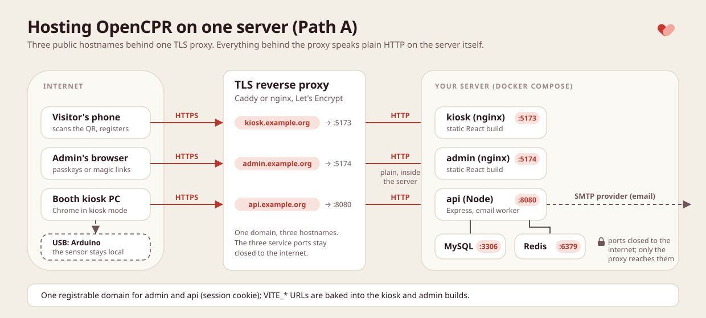

<!-- cspell:ignore hostnames mysqldump Mailgun Mailpit Postmark Caddyfile -->

# Host the software

Part of: [Getting started](getting-started.md) › Host the software

Where the API, the kiosk app and the admin portal run, and the settings that tie them together. The booth computer only needs the kiosk's public address.

## What runs where

Three services, one database, one queue:

| Service | What it is | Needs |
| --- | --- | --- |
| API ([`backend/`](../backend)) | Node 24 + Express. Stores and ranks runs, signs admins in, runs the email worker and the kiosk health job in the same process | MySQL 8, Redis 7, an SMTP account, a public HTTPS hostname |
| Kiosk ([`frontend/`](../frontend)) | A static React build, served by any web server with a single-page fallback to `index.html` | A public HTTPS hostname and the API's URL baked in at build time |
| Admin portal ([`admin-portal/`](../admin-portal)) | A static React build, same shape as the kiosk | A public HTTPS hostname sharing a registrable domain with the API |

The repository provides the code, a `Dockerfile` for each service, a root [`docker-compose.yml`](../docker-compose.yml) that runs every piece on a laptop (database migrations, a demo seed and a local mail catcher included), a [`docker-compose.prod.yml`](../docker-compose.prod.yml) override that turns it into a production setup, and an `.env.example` in each folder documenting every variable. The organization provides the hosts, the domain names, TLS, an SMTP email account, and backups.

## Why HTTPS is not optional

The kiosk reads the sensor through Web Serial, which browsers expose only in a secure context, so the kiosk must be served over HTTPS (plain `http://localhost` is the one exception, which is why the Docker quickstart works on a laptop). Passkeys in the admin portal need the same. And the QR code sends visitors' phones to the kiosk's origin, so that origin must be public, not a venue-only address.

## What the API leaves open

The endpoints a booth and a visitor's phone call need no sign-in: saving a run (`POST /api/cpr-sessions`), the phone registration and the kiosk's poll for it (`/api/cpr-sessions/:publicId/claim`), and the kiosk heartbeat (`POST /api/kiosks/:kioskId/heartbeat`). A booth has no account, and the location and kiosk ids in these requests are whatever the caller sends. Anyone who can reach the API can post made-up runs for any location, which skews its statistics, and send heartbeats that make a kiosk look online, offline or in maintenance. The rate limits are per IP address, so they slow one client down without stopping it.

In practice: expose the API only through the TLS reverse proxy (Path A binds it to `127.0.0.1` and the firewall closes every other port), and watch the admin portal for runs and kiosks you do not expect. See also [SECURITY.md](../SECURITY.md#known-limitations).

## Settings that have to agree

Names are the ones in the `.env.example` files. On Path A they all live in the `.env` at the repository root.

- [ ] `APP_ENV` on the API: `production` when hosted (the allowed values are `local`, `development`, `staging` and `production`). Anything other than `local` marks the admin session cookie `Secure` and makes Express trust one proxy hop, so the API must sit behind exactly one reverse proxy (or change `trust proxy` in `backend/src/app.ts`); `production` also turns off the `/debug-sentry` route. The production override sets it for you.
- [ ] `ADMIN_APP_URL`: the exact origin the admin portal is served from. It is where magic links point, the only origin the API sends session cookies to, and the only origin a passkey ceremony is accepted from.
- [ ] `ADMIN_RP_ID`: the admin's registrable domain (`example.org` for `admin.example.org`), no scheme or port. Passkeys are bound to it; changing it later orphans every enrolled passkey. The admin portal and the API must share that registrable domain, because the session cookie is `SameSite=Lax`.
- [ ] `BOOTSTRAP_ADMIN_EMAIL`: the first admin, created on boot. Every other user is invited from the portal.
- [ ] `SMTP_HOST`, `SMTP_PORT`, `SMTP_SECURE`, `SMTP_USER`, `SMTP_PASSWORD` and `EMAIL_FROM_ADDRESS`: the API sends every email over SMTP, so any provider works (SendGrid, Postmark, Amazon SES, Mailgun, or your own mail server). `SMTP_PORT` defaults to 587; port 465 needs `SMTP_SECURE=true`; `SMTP_USER` and `SMTP_PASSWORD` are set together or not at all. The sender must be one the provider lets you send from, or the magic links never arrive and nobody can sign in.
- [ ] `MYSQL_PASSWORD`: a long random password. The MySQL container uses it for both the `opencpr` user and root.
- [ ] `VITE_API_URL` in both front ends: the API's public URL including `/api`, baked into the bundle at build time. The API answers any origin, so the kiosk's hostname needs no configuration on the API side.
- [ ] `VITE_PUBLIC_URL` in the kiosk: its own public origin, used to build the QR code.
- [ ] `VITE_APP_ENV=production` for the hosted builds (`local` turns on development tooling). The production override builds with it.
- [ ] `SENTRY_DSN` and the `VITE_SENTRY_DSN`s: optional; leave them empty to run without Sentry.
- [ ] The consent text and the terms page: see [Your organization's text](#your-organizations-text).

## Path A: one small VPS

Most organizations should take this path.



A single virtual server with 2 GB of RAM and Docker runs the root `docker-compose.yml` together with `docker-compose.prod.yml`: MySQL, Redis, the API on port 8080 and the two static sites on 5173 and 5174, all plain HTTP on the server itself. A TLS reverse proxy on the same server (Caddy below, or nginx with Let's Encrypt) answers on three hostnames, `kiosk.`, `admin.` and `api.` under one domain, and forwards each to its port.

The production override differs from the laptop setup in these ways:

- MySQL and Redis publish no port, and Mailpit is not started. The API sends email through your SMTP provider.
- The kiosk, admin and API ports are bound to `127.0.0.1`, so only the reverse proxy on the same server reaches them.
- Startup runs the database migrations and never the demo seed, which resets the database and adds an example location.
- `APP_ENV` and `VITE_APP_ENV` are `production`.
- Every service except the one-off migration restarts after a crash or a reboot.
- `docker compose` refuses to start while `MYSQL_PASSWORD`, `SMTP_HOST`, `EMAIL_FROM_ADDRESS`, `ADMIN_APP_URL`, `ADMIN_RP_ID`, `BOOTSTRAP_ADMIN_EMAIL`, `VITE_API_URL`, `VITE_PUBLIC_URL` or `VITE_APP_NAME` is empty, and names the missing one.

It cannot tell a laptop value from a real one, so go through every line of `.env`.

### 1. Point three names at the server

At your DNS provider, create three records for the server's public address: `kiosk.example.org`, `admin.example.org` and `api.example.org` (an `A` record each for IPv4, plus an `AAAA` record each if the server has IPv6). Use your own domain; the admin and API names must share it.

### 2. Close everything but the proxy

Allow only ports 80 and 443 (the proxy, which also uses 80 to get its certificates) and 22 (SSH, ideally limited to your own address) in the server's firewall or your cloud provider's security group. Everything else stays closed.

### 3. Fill in `.env`

```sh
git clone <repository URL> opencpr && cd opencpr
cp .env.example .env
```

Edit `.env` following [Settings that have to agree](#settings-that-have-to-agree) and the comments in the file. For the example domain:

```sh
COMPOSE_FILE=docker-compose.yml:docker-compose.prod.yml
MYSQL_PASSWORD=<long random password>
EMAIL_FROM_ADDRESS=booth@example.org
SMTP_HOST=smtp.your-provider.example
SMTP_PORT=587
SMTP_USER=<provider user>
SMTP_PASSWORD=<provider password>
ADMIN_APP_URL=https://admin.example.org
ADMIN_RP_ID=example.org
BOOTSTRAP_ADMIN_EMAIL=you@example.org
VITE_API_URL=https://api.example.org/api
VITE_PUBLIC_URL=https://kiosk.example.org
```

The `COMPOSE_FILE` line makes every `docker compose` command in that folder use the production override, so a plain `docker compose up` can never start the laptop setup on the server. The commands below spell out both files anyway.

### 4. Set up the reverse proxy

Install Caddy from its [install page](https://caddyserver.com/docs/install); it gets and renews the TLS certificates by itself once the DNS records resolve. Replace `/etc/caddy/Caddyfile` with:

```caddyfile
kiosk.example.org {
	reverse_proxy 127.0.0.1:5173
}

admin.example.org {
	reverse_proxy 127.0.0.1:5174
}

api.example.org {
	reverse_proxy 127.0.0.1:8080
}
```

Then `sudo systemctl reload caddy`. Do not put a second proxy (a CDN in proxy mode, a load balancer) in front of Caddy: the API trusts exactly one hop.

### 5. Start it

```sh
docker compose -f docker-compose.yml -f docker-compose.prod.yml up --build -d
```

The front-end URLs are baked in at build time, so `.env` must be complete before this first build; after changing a `VITE_*` value, run the same command again. The first start creates the database schema and the bootstrap admin.

### 6. Check it worked

1. Open `https://api.example.org/health`; it answers `All systems operational` once the API reaches MySQL and Redis.
2. Open `https://admin.example.org`, enter the `BOOTSTRAP_ADMIN_EMAIL` address and open the magic link that arrives by email. No email means the SMTP settings are wrong: `docker compose -f docker-compose.yml -f docker-compose.prod.yml logs api` shows why.
3. In the admin portal, create the location before the first booth boots; see [Before the first day](booth-operations.md#before-the-first-day).
4. Open `https://kiosk.example.org`; the kiosk app loads.

### Updating

```sh
git pull
docker compose -f docker-compose.yml -f docker-compose.prod.yml up --build -d
```

The migration step applies any new database migrations before the API starts. If you changed the consent text, merge the update into your branch instead; see [Your organization's text](#your-organizations-text).

## Path B: static hosts plus a Node service

Build `frontend/` and `admin-portal/` with `pnpm build` (with their `VITE_*` variables set) and upload `dist/` to any static host that supports a single-page fallback; the frontend README shows the nginx rule. Run the API as a Node 24 service on a PaaS or a managed container platform (`pnpm build`, `pnpm db:migrate`, then `pnpm start:prod`), attached to a managed MySQL 8 and a managed Redis 7, with the API's environment set from `backend/.env.example` and `APP_ENV=production`. Its `/health` endpoint answers for health checks. Keep the admin portal's hostname and the API's under one registrable domain.

Both paths need the location created in the admin portal before the first booth boots, with the details from [Plan the booth](getting-started.md#plan-the-booth); see [Before the first day](booth-operations.md#before-the-first-day).

## Your organization's text

The registration form on the visitor's phone asks for consent before anyone can register. Its text is `claim.consent` in `frontend/src/i18n/locales/en.json`: replace `[YOUR ORGANIZATION]` with the organization that holds the data, and make the sentence match your privacy policy. There is no setting for it; it is part of the kiosk build.

The kiosk also has a `/terms` page (`frontend/src/routes/(public)/terms.page.tsx`) that is only a placeholder and no screen links to it. Replace it with your organization's own terms before you point anyone at it, or leave it unlinked.

Because both are source edits, keep them on a branch of your own (or in a fork) so `git pull` does not conflict with them:

```sh
git switch -c our-booth
# edit en.json (and the terms page), then
git commit -am "chore: our consent text"
```

To update, fetch and merge the new release into that branch, then rebuild:

```sh
git fetch origin
git merge origin/main
docker compose -f docker-compose.yml -f docker-compose.prod.yml up --build -d
```

A conflict in `en.json` means the release changed a string next to yours; keep your consent text and take the rest.

## Backups

The repository does not back up MySQL. Schedule a dump of the `opencpr` database somewhere off the server; it is the only state worth keeping (Redis holds queued jobs and can be lost). On Path B, use the managed database's backups. On Path A, a nightly dump through the MySQL container does it, run from the repository folder:

```sh
docker compose -f docker-compose.yml -f docker-compose.prod.yml exec -T mysql \
  sh -c 'exec mysqldump --single-transaction -u root -p"$MYSQL_ROOT_PASSWORD" "$MYSQL_DATABASE"' \
  | gzip > opencpr-$(date +%F).sql.gz
```

Copy the file off the server (object storage, another machine) and keep several days of them; a dump that only lives on the server is lost with it. The dumps hold participants' names and emails, so store them as carefully as the database. To restore one into a running stack:

```sh
gunzip -c opencpr-2026-01-31.sql.gz | docker compose -f docker-compose.yml -f docker-compose.prod.yml exec -T mysql \
  sh -c 'exec mysql -u root -p"$MYSQL_ROOT_PASSWORD" "$MYSQL_DATABASE"'
```

Next: [Set up the booth computer](../scripts/booth/README.md).
